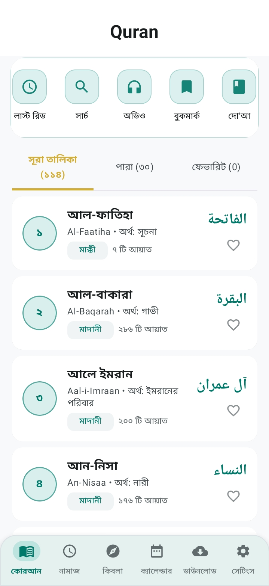
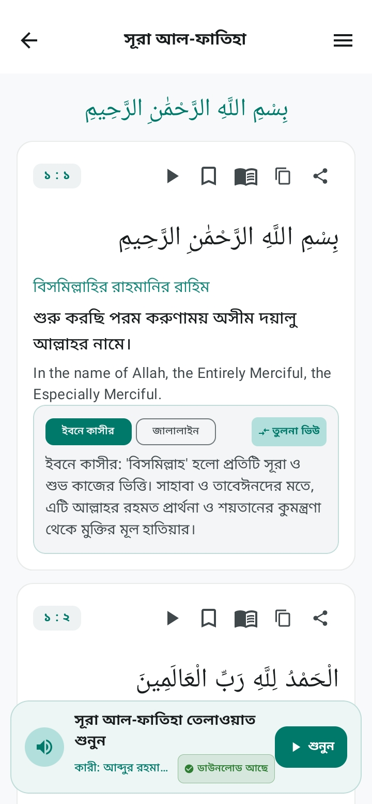
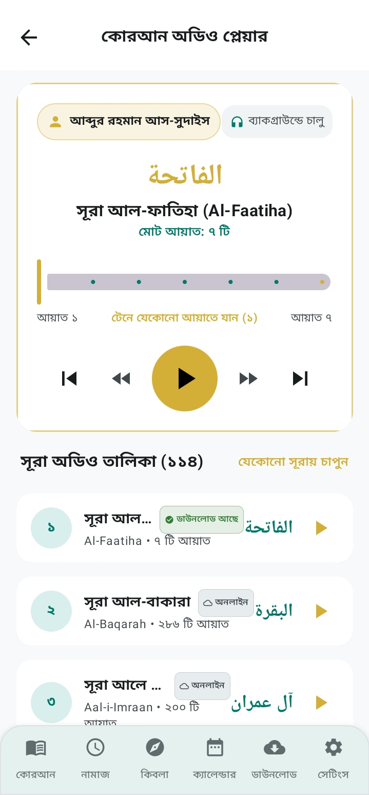
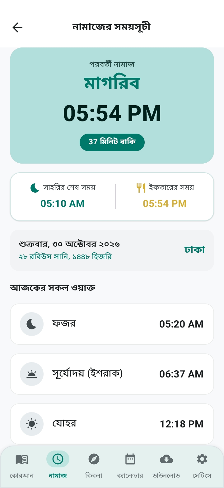
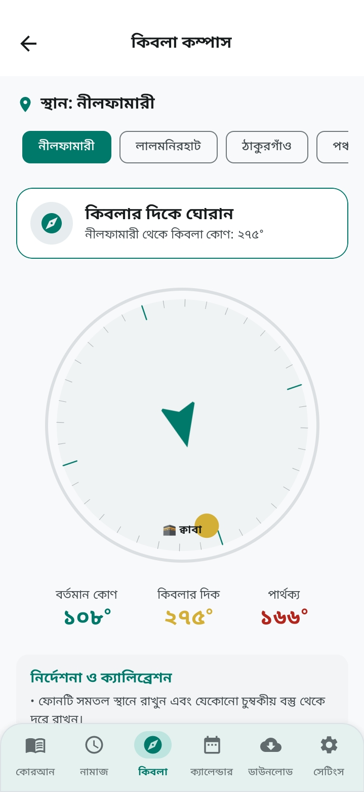
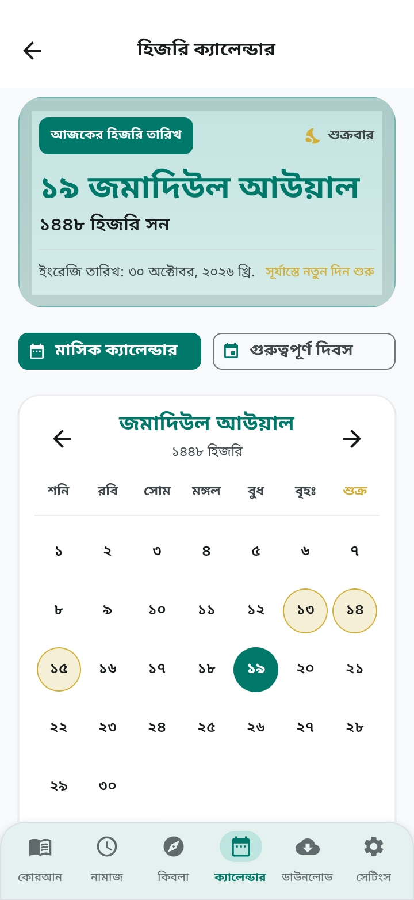

# 📖 পবিত্র আল-কুরআন (Quran)

### বাংলা ভাষাভাষী মুসলিমদের জন্য একটি পূর্ণাঙ্গ ইসলামিক Android অ্যাপ।

  <a href="https://mahafuzar.ai.studio">
    
  </a>
  <a href="mailto:mdmahafuzarrahmanmaruf@gmail.com">
    
  </a>
  <a href="https://github.com/mdmahafuzarrahmanmaruf/Quran/releases/tag/Quran_v1.4.2">
    
  </a>

  
  
  
  

---

## 🌙 আমাদের সম্পর্কে

পবিত্র আল-কুরআন (Quran) একটি পূর্ণাঙ্গ ইসলামিক Android অ্যাপ, যা বাংলাদেশের বাংলা ভাষাভাষী মুসলিমদের কথা বিবেচনা করে তৈরি করা হয়েছে।

একটি অ্যাপের মধ্যেই পবিত্র আল-কুরআন পড়া, অডিও তিলাওয়াত শোনা, বাংলা ও ইংরেজি অনুবাদ, তাফসির, নামাজের সময়সূচি, কিবলা নির্ণয় এবং আরও অনেক প্রয়োজনীয় ইসলামিক সুবিধা উপভোগ করতে পারবেন।

আমাদের উদ্দেশ্য হলো প্রযুক্তির মাধ্যমে পবিত্র কুরআন ও ইসলামিক জ্ঞানকে সবার কাছে সহজলভ্য করে তোলা।

## ✨ অ্যাপের বিশেষ সুবিধাসমূহ

### 📖 পবিত্র আল-কুরআন
- সম্পূর্ণ ১১৪টি সূরা পড়ার সুবিধা।
- সুন্দরভাবে সাজানো কুরআনের আয়াত।
- সহজে সূরা ও আয়াত খুঁজে পাওয়ার সুবিধা।
- বুকমার্ক করে পছন্দের আয়াত সংরক্ষণ।

### 🌍 অনুবাদ ও তাফসির
- বাংলা অনুবাদ।
- ইংরেজি অনুবাদ।
- আয়াতের বিস্তারিত তাফসির।
- শানে নুযুল (আয়াত নাজিলের প্রেক্ষাপট)।

### 🎧 অডিও তিলাওয়াত
- একাধিক বিখ্যাত কারীর কণ্ঠে তিলাওয়াত।
- সূরা অনুযায়ী অডিও শোনার সুবিধা।
- অডিও ডাউনলোড করার সুবিধা।
- ডাউনলোড করা অডিও পুনরায় শোনার সুবিধা।

### 🕌 নামাজ ও ইবাদত
- দৈনিক পাঁচ ওয়াক্ত নামাজের সময়সূচি।
- কিবলা কম্পাস।
- নামাজের সময় অনুযায়ী ইবাদতের প্রস্তুতি।

### 📅 ইসলামিক ক্যালেন্ডার
- ইসলামিক হিজরি ক্যালেন্ডার।
- গুরুত্বপূর্ণ ইসলামিক তারিখ দেখার সুবিধা।
- প্রয়োজনীয় ইসলামিক দিনের তথ্য।

### ⭐ অন্যান্য সুবিধা
- পছন্দের আয়াত বুকমার্ক।
- সহজ ও ব্যবহারবান্ধব ইন্টারফেস।
- প্রয়োজনীয় ইসলামিক তথ্য এক জায়গায়।
- একাধিক সুবিধা একটি অ্যাপের মধ্যেই।

---

## 📥 অ্যাপটি ডাউনলোড করুন

### আপনার Android ফোনে এখনই ইনস্টল করুন।

<a href="https://github.com/mdmahafuzarrahmanmaruf/Quran/releases/tag/Quran_v1.4.2">
  
</a>

সম্পূর্ণ বিনামূল্যে ডাউনলোড করুন।

---

## 📱 অ্যাপের কিছু স্ক্রিনশট

এখানে আপনার অ্যাপের স্ক্রিনশট যুক্ত করুন।

| হোম স্ক্রিন | কুরআন পাঠ | অডিও তিলাওয়াত |
|:---:|:---:|:---:|
|  |  |  |

| নামাজের সময় | কিবলা কম্পাস | ইসলামিক ক্যালেন্ডার |
|:---:|:---:|:---:|
|  |  |  |

---

## 🛠️ প্রযুক্তি

এই প্রজেক্টটি Android অ্যাপ হিসেবে তৈরি করা হয়েছে।

- Android Studio
- Android SDK
- Java / Kotlin

---

## 🤝 আমাদের সঙ্গে যুক্ত হোন

এই প্রজেক্টটি আরও উন্নত করতে আপনার সহযোগিতা আমাদের জন্য গুরুত্বপূর্ণ।

আপনি চাইলে:

- নতুন ফিচারের পরামর্শ দিতে পারেন।
- কোনো সমস্যা বা বাগ রিপোর্ট করতে পারেন।
- সোর্স কোডে অবদান রাখতে পারেন।
- বন্ধুদের সঙ্গে অ্যাপটি শেয়ার করতে পারেন।

আপনার সহযোগিতায় এই উদ্যোগ আরও এগিয়ে যাবে।

---

---

## 📩 যোগাযোগ

অ্যাপ সম্পর্কে কোনো পরামর্শ, অভিযোগ অথবা সহযোগিতার জন্য আমাদের সঙ্গে যোগাযোগ করুন।
- 🌐 ওয়েবসাইট: https://mahafuzar.ai.studio
- ✉️ ইমেইল: mdmahafuzarrahmanmaruf@gmail.com
- 💻 GitHub: https://github.com/mdmahafuzarrahmanmaruf

---

### ❤️ প্রযুক্তির মাধ্যমে কুরআনের আলো ছড়িয়ে পড়ুক সবার মাঝে।

## Made with ❤️ in Bangladesh 🇧🇩 MD Mahafuzar Rahman

⭐ ভালো লাগলে GitHub Repository-তে Star দিতে ভুলবেন না।

